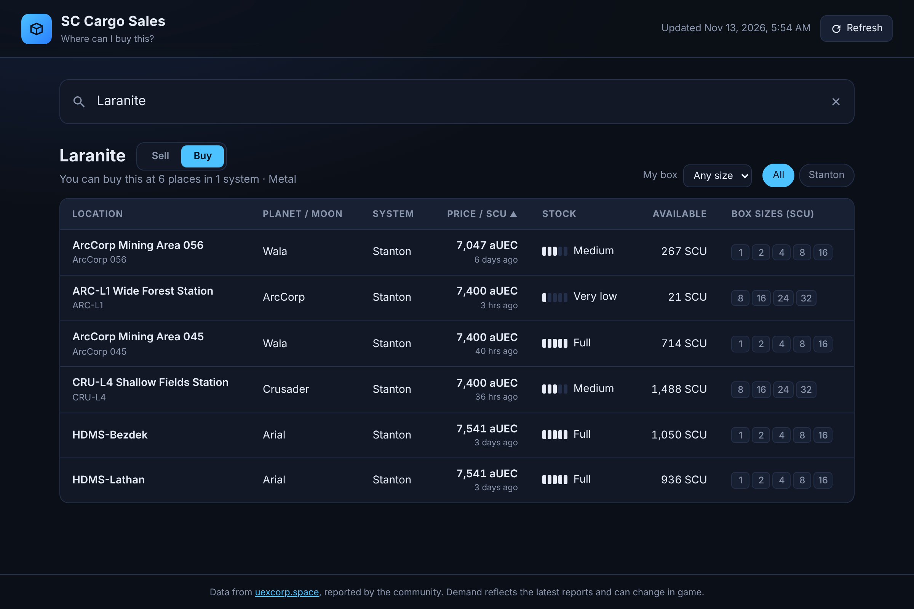
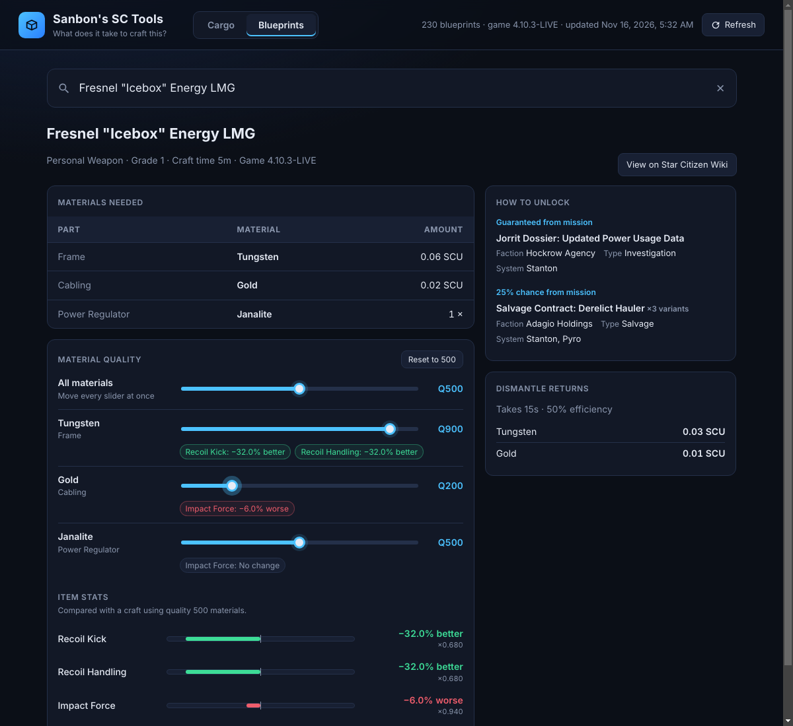

# Sanbon's SC Tools

A small, dark-mode Windows desktop app for Star Citizen players, with two tabs:

- **Cargo**: type a commodity and see every terminal in the 'verse where you can **sell** it (or flip the toggle to see where you can **buy** it).
- **Blueprints**: look up a crafting blueprint to see the materials it needs, and move the quality sliders to see how material quality changes the crafted item's stats.





## Cargo tab

For each terminal that trades the commodity:

- **Location**: terminal name, plus the planet or moon it's on
- **System**: Stanton, Pyro, and so on
- **Demand**: how much the terminal wants it (or how much stock it has, in Buy mode)
- **Box sizes**: the SCU container sizes the terminal accepts
- **Latest price**: the most recent price reported by the community

Click any column header to sort.

## Blueprints tab

Search for a blueprint to see its parts, materials and amounts, plus how to unlock it. The **Material quality** card has a slider (0 to 1000) for each material and an "All materials" slider. **Item stats** shows how each stat changes compared with crafting from quality 500 materials, in green for better and red for worse.

## Where the data comes from

Cargo data comes from the public [UEX](https://uexcorp.space) API. Blueprint data comes from the [Star Citizen Wiki API](https://api.star-citizen.wiki). The app loads it once at startup and keeps a local copy, so it still opens if you're offline. Hit **Refresh** to pull the latest numbers. No account or API token is needed.

Both tabs keep a local copy of their data. Prices and demand are crowd-reported by UEX users, so they can be out of date. If a terminal shows "Not reported", nobody has submitted data for it yet.

## Download

Grab the latest Windows build from the [Releases](../../releases) page, unzip it anywhere, and run `Sanbons SC Tools.exe`. No installer needed.

The build isn't code-signed, so Windows SmartScreen may warn you the first time. Click **More info → Run anyway**.

## Run or build from source

You need [Node.js](https://nodejs.org) 18 or newer.

```bash
npm install
npm start            # run the app
npm run package:win  # build a portable Windows app into dist/
```

The UI is plain HTML, CSS and JavaScript in `app/`, with a thin Electron shell in `main.js`.

## What's new

See the [changelog](CHANGELOG.md).

## Credits

- Market data: [UEX Corp](https://uexcorp.space). Huge thanks to the UEX team and everyone who submits prices.
- Blueprint data: the [Star Citizen Wiki](https://star-citizen.wiki) community.
- Built with [Electron](https://www.electronjs.org).

## Disclaimer

This is an unofficial fan-made tool. It is not affiliated with, endorsed by, or connected to Cloud Imperium Games, Roberts Space Industries, UEX, or the Star Citizen Wiki. Star Citizen® is a registered trademark of Cloud Imperium Rights LLC.

## License

[MIT](LICENSE)
